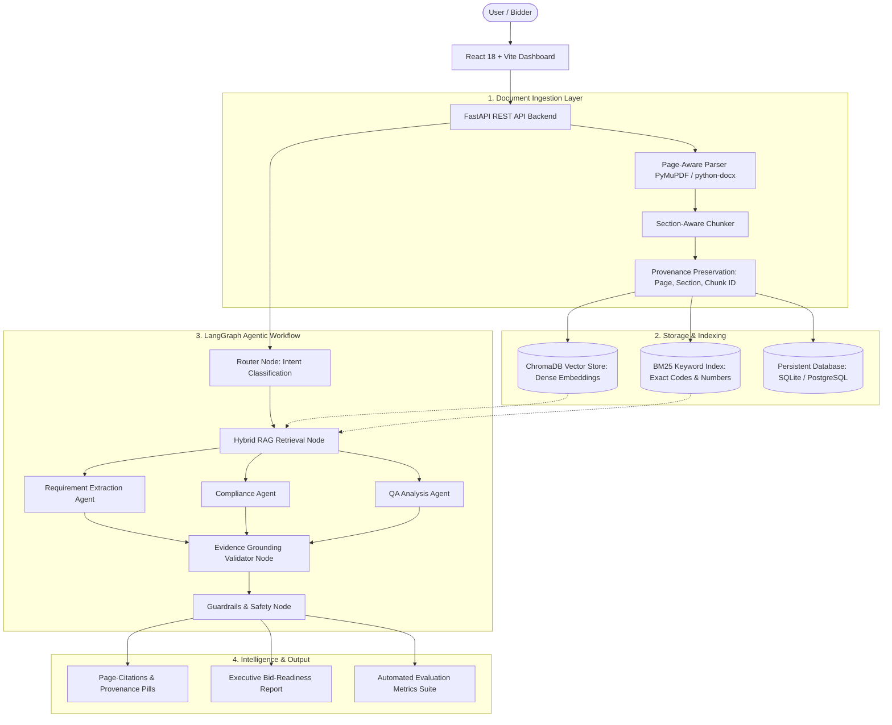

# 🛡️ TenderSense AI
### Agentic Tender & Compliance Intelligence Platform

A resume-ready, production-grade document intelligence platform that analyzes government and enterprise tender RFPs (PDF/DOCX), extracts structured eligibility criteria, runs hybrid retrieval (ChromaDB + BM25), evaluates company compliance using LangGraph agent orchestration, validates evidence provenance, and enforces guardrails.

---

## 🌟 Architecture & Workflow



---

## 🚀 Key Features

1. **Deterministic Page-Aware Ingestion**:
   - Parses multi-page PDF (`PyMuPDF`) and Word (`python-docx`) RFPs.
   - Extracts page numbers, headings, and markdown tables without losing provenance.
   - Section-aware chunking preserving: `{chunk_id, document_id, text, page, section, heading}`.

2. **Hybrid RAG (Vector + BM25 with Rank Fusion)**:
   - **ChromaDB**: Semantic vector retrieval for conceptual clauses.
   - **BM25Okapi**: Sparse keyword retrieval preserving exact identifiers (e.g. `ISO 9001`, `IS 456:2000`, `₹15 crore`, `EMD ₹5,00,000`).
   - **Score Fusion**: Combines normalized vector cosine similarity, BM25 scores, and Reciprocal Rank Fusion (RRF).

3. **LangGraph Agentic Orchestration**:
   - **Router Agent**: Dynamically classifies query intent into Requirement Extraction, Compliance Evaluation, QA Retrieval, or Executive Reporting.
   - **Requirement Agent**: Normalizes criteria into categories: `Eligibility`, `Technical`, `Financial`, `Certifications`, `Documentation`, `Delivery`, `Evaluation`.
   - **Compliance Agent**: Compares tender requirements with Company Profile, scoring items into `SATISFIED`, `MISSING`, `RISKY`, or `CLARIFICATION_NEEDED`.
   - **Evidence Validator**: Cross-checks factual claims against source chunks, eliminating ungrounded speculation.
   - **Tender Guardrails**: Rejects or qualifies low-confidence responses and prevents hallucinating unstated requirements.

4. **Executive Bid-Readiness Reporting**:
   - Computes readiness score (0-100%) and overall verdict: `QUALIFIED`, `PARTIAL`, or `DISQUALIFIED`.
   - Formats granular gap analysis, disqualification hazards, and pre-bid clarification action items.
   - Exportable to Markdown and printer-friendly HTML / PDF.

5. **Automated AI Evaluation Suite**:
   - Benchmarks system performance across 12 ground-truth questions.
   - Metrics: **Retrieval Recall**, **Answer Accuracy**, **Citation Accuracy**, **Hallucination Rate**, and **Average Latency (ms)**.

6. **Full-Stack Interactive Dashboard**:
   - 8 product screens: Dashboard, Tender Analysis, Requirement Detail, AI Evidence Chat, Compliance Matrix, Company Profile, Executive Report, and Evaluation Suite.

---

## 📂 Repository Structure

```
docShield_AI/
├── backend/
│   ├── main.py                     # FastAPI REST API & routes
│   ├── config.py                   # Pydantic Settings & environment variables
│   ├── database.py                 # SQLAlchemy DB engine & session
│   ├── models.py                   # ORM models & Pydantic schemas
│   ├── ingestion/
│   │   ├── parser.py               # Page-aware PDF/DOCX parser
│   │   └── chunker.py              # Section-aware chunker with provenance
│   ├── retrieval/
│   │   ├── bm25_index.py           # Procurement-optimized BM25
│   │   ├── vector_store.py         # ChromaDB persistent vector storage
│   │   └── hybrid_retriever.py     # Hybrid search with rank fusion
│   ├── agents/
│   │   ├── router.py               # Intent classifier
│   │   ├── requirement_agent.py    # Structured requirement extractor
│   │   ├── compliance_agent.py     # Bid-readiness matcher
│   │   ├── evidence_agent.py       # Grounding validator & citations
│   │   └── llm_client.py           # Multi-provider LLM (Gemini, OpenAI, Offline fallback)
│   ├── graph/
│   │   ├── state.py                # LangGraph state schema
│   │   └── workflow.py             # Compiled StateGraph workflow
│   ├── guardrails/
│   │   └── guardrail.py            # Procurement guardrails & safety rules
│   ├── reporting/
│   │   └── generator.py            # Executive report generator
│   └── evaluation/
│       ├── benchmark_dataset.py    # Ground truth benchmark QA dataset
│       └── evaluator.py            # Evaluation metrics engine
├── frontend/                       # React 18 + Vite web dashboard
│   ├── src/
│   │   ├── App.jsx                 # Multi-tab dashboard UI
│   │   ├── index.css               # Clean modern responsive styling
│   │   └── main.jsx
│   └── vite.config.js              # Proxy configuration
├── documents/                      # Sample PDF and DOCX tenders
│   ├── sample_smart_city_tender.pdf
│   └── sample_highway_tender.docx
├── tests/                          # Automated Pytest test suite
│   ├── test_ingestion.py
│   ├── test_retrieval.py
│   ├── test_agents.py
│   ├── test_compliance.py
│   ├── test_guardrails.py
│   └── test_api.py
├── run_dev.py                      # One-click launcher for backend + frontend
├── Dockerfile                      # Container build
├── docker-compose.yml              # Multi-container deployment
├── requirements.txt                # Python dependencies
├── .env.example                    # Sample environment variables
└── README.md                       # Documentation
```

---

## 🛠️ Quick Start Guide

### 1. Prerequisites
- Python 3.10+ (tested on Python 3.14)
- Node.js 18+ and npm

### 2. Backend Setup
```bash
# Install Python dependencies
pip install -r requirements.txt

# (Optional) Set API keys in .env if you wish to use Cloud LLMs
# If omitted, TenderSense AI seamlessly runs on its built-in Deterministic Procurement Engine!
cp .env.example .env
```

### 3. Frontend Setup
```bash
cd frontend
npm install
cd ..
```

### 4. Run the Full Application
You can start both backend and frontend simultaneously with the launcher script:
```bash
python run_dev.py
```
Or start them in separate terminals:
- **Backend API**: `python -m uvicorn backend.main:app --host 127.0.0.1 --port 8000 --reload` (Swagger UI: `http://127.0.0.1:8000/docs`)
- **Frontend Dashboard**: `cd frontend && npm run dev` (`http://localhost:3000`)

---

## 🧪 Running Tests & Evaluation Suite

Run the full automated pytest suite:
```bash
pytest -v
```

Expected result:
```
======================= 14 passed in 10.12s =======================
```

---

## 💼 Resume & Interview Talking Points

- **Why Hybrid Retrieval?**
  Tender RFPs contain both semantic concepts (*"robust incident management"*) and strict literal identifiers (*"IS 456:2000"*, *"ISO 27001"*, *"turnover >= 15 Cr"*). Combining dense vector search with BM25 keyword search prevents missing exact clause codes that dense embeddings alone often overlook.

- **Why LangGraph Agent Orchestration?**
  Procurement analysis is a stateful multi-step decision pipeline: intent classification → hybrid passage retrieval → structured schema normalization → profile comparison → evidence grounding → guardrail enforcement. LangGraph provides explicit node state transitions and conditional routing.

- **Why Strict Citations & Guardrails?**
  Decision support for bids involves financial commitments. If an answer claims a requirement exists when it does not, bidders face disqualification. The guardrails verify that entity tokens exist in the retrieved passages and qualify answers when retrieval confidence drops below threshold.

- **Why Evaluation Suite?**
  Proves production readiness by measuring quantitative metrics (**Retrieval Recall**, **Answer Accuracy**, **Citation Accuracy**, **Hallucination Rate**, **Latency**) against ground-truth benchmarks rather than relying on subjective demo impressions.
